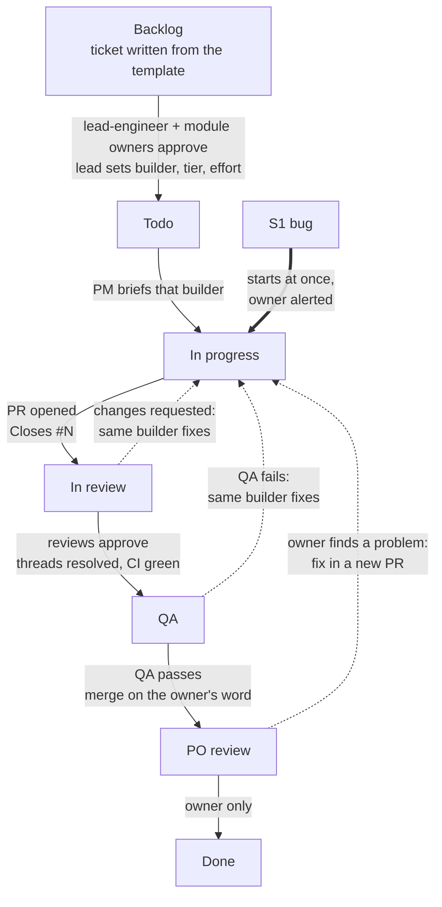
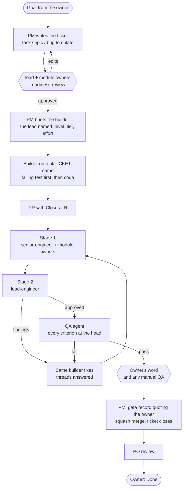

# Working flow for a vibe-coded project

This is a way of working for a solo developer who builds a product with AI agents. It was worked out on a real
project and written down here in generic form, so that a new project can start with it on day one. It is not
installed by `bootstrap.sh`. Copy what you want into your project, and adapt the names to your project's modules
and risks.

What vibe-setup gives you, and what you add per project:

| From vibe-setup (packs) | You add in each project |
|---|---|
| Reviewer agents (`senior-engineer`, `lead-engineer`, `mid-level-engineer`), read-only | Your module owners: one reviewer agent per risky module, also read-only |
| Builder agents (`junior-dev`, `mid-dev`, `senior-dev`, `lead-dev`, `pm` pack), the only ones with write tools | |
| `/gated-review` (`pm` pack), the two-stage review; `/tiered-review` for a one-tier quick check | Which paths go to which owner, and which paths get the full gate |
| `/pickup`, `/learn`, `/handoff` and `.agent-memory/` (`memory` pack) | `AGENTS.md` with the rules below, a spec (`SPEC.md`) and a task list |
| `project-manager` and `github-api` skills (`pm` pack), and domain skills (packs) | The project-manager skill's "Fill in for your project" section: your board ids, module owners, ask-first list and merge rule |
| | Ticket and bug templates (see [ticket-templates.md](ticket-templates.md)) |

## 1. Who does what

| Who | Decides or does |
|---|---|
| **Owner** (you) | Goals and scope. The word to merge, and always for ask-first areas. Manual QA when a check needs a person. The final move to Done. Spec and architecture decisions, and accepting a residual risk. |
| **Project manager (PM)** | The one session that talks with you. Writes tickets from your goals, keeps the board current, picks and briefs builders, runs the reviews, posts the records, and brings you every decision that is yours. It does not build or review. |
| **lead-engineer** | Reviews every ticket for readiness and sets its builder, tier and effort. Stage 2 of every PR. Rules when reviewers, specs or architecture decisions disagree. |
| **Module owners** | Readiness of tickets in their module. Stage 1 review of their module's code and specs. |
| **senior-engineer** | Stage 1 line-by-line review of every PR. |
| **QA agent** | Checks every acceptance criterion against the PR's head commit and posts the result. |
| **Builders** | Build test-first on a task branch, open the PR linked to its ticket, and fix their own findings. They never review, approve, QA or merge. |

Reviewers and QA stay read-only (`tools: Read, Grep, Glob`). An agent never reviews or QAs its own work.

## 2. Ticket lifecycle

- **Definition of Ready.** A new ticket starts in Backlog. It moves to Todo only after lead-engineer and the
  ticket's module owners approve it on the issue. A ticket with no module owner needs lead-engineer alone. Only a
  Todo ticket moves to In progress.
- **The lead sets the builder.** The lead's readiness verdict names the builder level, the tier and the effort.
  The PM copies it into the ticket as one line, for example "**Builder:** mid-dev, default tier, effort high (set
  by lead-engineer: link)". If the work turns out larger or smaller, it goes back to the lead first.
- **S1 bugs** (money or data at risk, a security hole, or the product down) start at once. The owner is alerted,
  the lead triages while the fix starts, and both approvals are recorded afterwards. The fix still passes the
  full review and QA.
- **Merge.** The PR's `Closes #N` closes the ticket when it merges. The PM then sets the card to PO review, even if
  the board's own automation set it to Done. Who may press merge is your rule. By default, every merge needs the
  owner's word in the session, quoted on the PR with its time. A project may switch on a rule in its `AGENTS.md`
  that lets the PM merge a clean PR at QA pass; a PR in an ask-first area always waits for the owner's word.

## 3. One ticket, end to end

## 4. Builders: who builds what, at what effort

Name builders by level and a letter, for example "mid-dev A". Give each one the skills its work needs, and the
effort the lead set.

| Builder | Typical work | Effort |
|---|---|---|
| **junior-dev** | Docs, renames, small config, tests for existing code | low to medium |
| **mid-dev** | A routine feature in one module, following existing patterns | medium to high |
| **senior-dev** | Money, concurrency, security or cross-module work, and spec text | high to xhigh |
| **lead-dev** | Only the most complex work: architecture-level design, core data paths, recovery | xhigh to max |

- **Tiers, not model names.** Write the tier (top, default, mid, small) in tickets, commits and PR text, never a
  model name. The tier decides the model when the agent starts.
- **The same builder fixes its findings.** A review or QA finding goes back to the builder that wrote the change,
  as a message to the same agent, because it already has the context. A new builder starts only if that agent's
  context is gone, and then it gets a handoff note.

## 5. Reviews

- **Two stages.** `/gated-review` runs stage 1 (senior-engineer and every module owner the diff touches), then
  stage 2 (lead-engineer). Specs, architecture decisions, plans and money code get the full gate: every owner the
  diff touches.
- **One lead at a time.** Lead reviews run one after another, never two at once. Running two in parallel does not
  save usage; it only spends it faster, and two leads can rule differently on the same question.
- **The same lead rechecks.** Every recheck of a PR goes to the lead that already reviewed it, as a message to the
  same agent, so it does not re-read every file. A new lead starts only if that agent's context is gone.
- **Lighter effort for docs-only PRs.** A PR that changes only README files and pages under `docs/` (not design
  decisions) gets the lead at `medium` effort. Specs, architecture decisions, plans, rule files, scripts and CI keep
  full effort.
- **On the PR.** The PM posts each read-only reviewer's verdict as a GitHub review, with each finding as an
  inline comment on its line. Every thread gets a reply and is resolved before merge: fixed (name the commit),
  ruled out (quote the ruling), or carried to a named follow-up.

## 6. GitHub conventions

- **Every PR names its ticket.** `Closes #N` when it finishes the ticket. `Refs #N` for part of one, plus a
  comment from the PM on the ticket, because `Refs` does not link on the board.
- **Every comment is signed.** Every comment, review and review reply starts with one line naming the agent whose
  words it is, for example `**Agent:** lead-engineer (default tier) · posted by the project manager`. A PR body
  names the builder that opened it.
- **The board** (GitHub Projects):
  - Status runs Backlog, Todo, In progress, In review, QA, PO review, Done;
  - sprints are the Iteration field (two weeks each), not labels;
  - an epic is an issue labelled `epic`, with its tickets as sub-issues.
- **Useful views:**
  - an epic tracker, grouped by Status;
  - a sprint planner, grouped by Iteration;
  - a hierarchy view, epics with their tickets;
  - a roadmap.
- **Board writes.** The PM moves cards through a GitHub Projects connector and reads each change back. If a
  write fails, it stops and reports the tool, its arguments and the error word for word. Only the owner moves a
  card to Done.

## 7. Ask-first areas

These wait for the owner's word to merge. Name your own in `AGENTS.md` and in the PM skill. Typical ones:

- money and balances: ledgers, payments, payouts, fees and limits;
- keys, signing, authentication, permissions and secrets;
- personal data and compliance checks;
- CI workflows, required checks, branch protection, dependency and secret-scanning config;
- the spec and architecture decisions;
- a new dependency, external host, data source or third-party service;
- anything public-facing or hard to reverse: publishing, deleting, changing repositories, migrations that have run;
- any item that needs manual QA.

## 8. Session rhythm

- **Start.** Run `/pickup` on the newest handoff; the session that talks with the owner then acts as PM.
- **During.** The PM keeps one status line per workstream, runs independent work in parallel (each builder in its
  own worktree), and keeps the lead reviews one at a time.
- **Pause.** When usage runs low, the PM:
  - stops the running agents;
  - writes a pause note with each PR's head, CI, the reviews so far and the next step;
  - leaves nothing half-pushed.
- **End.** Run `/learn` when there is a lesson, and `/handoff` so the next session can continue.

## 9. Adopting it in a new project

1. Install vibe-setup at project scope with the `roles`, `memory` and `pm` packs (see the README).
2. Write `AGENTS.md`: the working rules, the merge rule, the ask-first list, and the rules in sections 2 to 6.
3. Add your module-owner agents (read-only) and their paths in `/gated-review` (its section 3).
4. Copy the templates in [ticket-templates.md](ticket-templates.md) into `.github/ISSUE_TEMPLATE/`.
5. Create the board with the Status values and the Iteration field above, then the views.
6. Fill in the project-manager skill's last section: your board ids, ask-first list, merge rule and builder
   writes (module owners and the QA agent live in `/gated-review` sections 3 and 9).
7. Save the tailoring as a profile only if nothing in it is confidential: this repo is public.
